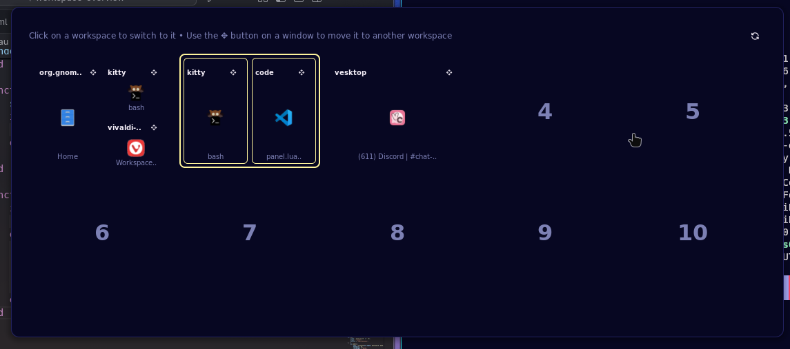

# Workspace Overview

A plugin for [Noctalia](https://github.com/noctalia-dev) v5 to see all workspaces and open windows at a glance, jump to any workspace with one click, and send windows from one workspace to another.



## Requirements

- Noctalia v5 (`plugin_api` 24)
- One of these Wayland compositors, with its CLI tool on your `PATH`:

| Compositor | Tool | Status |
| --- | --- | --- |
| Hyprland | `hyprctl` | Supported |
| Niri | `niri` | Supported |
| Sway / SwayFX | `swaymsg` | Not yet supported |

## Installation

Copy or clone this repository into your Noctalia plugins folder:

```sh
git clone https://github.com/Hugo8220337/workspace-overview \
  ~/.local/share/noctalia/plugins/hugo8220337/workspace-overview
```

Then restart Noctalia (or reload plugins).

## Usage

Open or close the panel with this IPC command:

```sh
noctalia msg panel-toggle hugo8220337/workspace-overview:workspace-overview-panel
```

Bind it to a key in your compositor config. For example, in Hyprland:

```ini
bind = SUPER, TAB, exec, noctalia msg panel-toggle hugo8220337/workspace-overview:workspace-overview-panel
```

### Controls

| Action | How |
| --- | --- |
| Go to a workspace | Click the workspace, or any window inside it |
| Move a window | Click the move button (✥) on the window, then click the destination workspace. You stay on your current workspace. |
| Cancel a move | Click the move button again, or press **Cancel** |
| Refresh | Click the refresh button |

> **Note: the move button is a workaround.** Noctalia v5 does not support drag and drop in plugin panels yet, so moving a window takes two clicks (select the window, then pick the destination) instead of dragging it. Once Noctalia adds drag and drop support, this plugin will switch to it.

## Settings

| Setting | Default | Description |
| --- | --- | --- |
| Maximum Workspaces Shown | `10` | How many workspaces appear in the grid (4 to 20) |
| Close Panel When Switching Workspace | `true` | Close the panel after you switch workspace |

## Development

For live updates, symlink the plugin folder into Noctalia's plugins directory:

```sh
mkdir -p ~/.local/share/noctalia/plugins/hugo8220337
ln -sfn /path/to/workspace-overview ~/.local/share/noctalia/plugins/hugo8220337/workspace-overview
```

## Roadmap

- Drag and drop windows between workspaces (blocked until Noctalia adds drag and drop support; the move button is a temporary workaround)
- Swap two windows across workspaces
